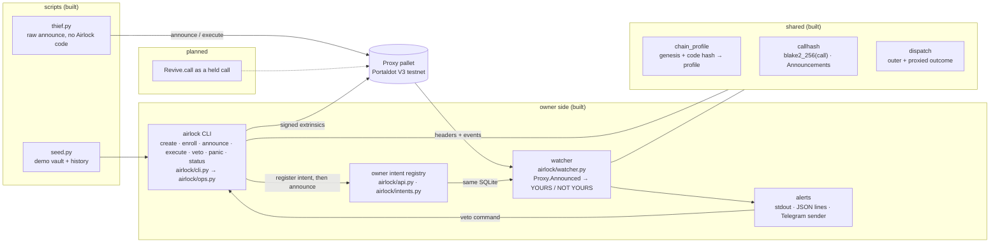

<div align="center">

# Airlock

**A time-locked hot key for a Portaldot vault: every spend is announced on-chain, waits out a delay, and your cold key can veto it first.**


</div>

> **Status: work in progress (check-in build).** Portaldot Hacker House 2026 · track: Ecosystem DApps. The Portaldot V3
> testnet was offline during the first build days (its announced RPC host did not resolve on 2026-10-14,
> [evidence/v3-dns.txt](evidence/v3-dns.txt)), so the runs below are on **labelled interim chains, not V3** (see
> [docs/PROOF.md](docs/PROOF.md)). V3 came back on 2026-10-19 at a new endpoint; Airlock identifies it by genesis and
> runtime code hash ([evidence/v3-day0-2026-10-19T150908Z.json](evidence/v3-day0-2026-10-19T150908Z.json)), and the core
> flow, the owner intent registry and the seeded demo history have since run **on V3** (rows labelled `v3` in PROOF.md).
> The interim rows keep their labels; the benchmark has not run on V3.

## Project Name

**Airlock** — repo `portaldot-hackathon-2026-airlock-edycu`.

## Project Overview

### Problem Statement

A POT holder who keeps funds on one hot key loses them in one block when that seed leaks. A multisig fixes this but
needs a second signer for every payment, which is heavy for one person. The Substrate Proxy pallet already ships a
better primitive, time-delayed proxies with announcements and a veto, but in our search (not a market survey) we have
not found a product built around it.

### Solution

Airlock creates a **pure-proxy vault**, a keyless account, controlled by two keys:

- **Hot key** — a proxy *with a delay D*. It cannot spend directly (`Proxy.Unannounced`). It can only
  `announce(vault, blake2_256(call))`, wait D blocks, then `proxy_announced`.
- **Cold key** — a proxy with delay 0. It can dispatch `reject_announcement` as the vault (the **veto**) before D
  elapses, or `remove_proxy` to retire the hot key (**panic**).

A **watcher** follows every block and alerts on each announcement against the vault, with the amount at risk, the
block by which a veto must land, and the exact `airlock veto …` command to paste. A leaked hot key therefore buys a
thief an announcement that the owner sees and cancels. A legitimate payment is the same flow with no veto.

### Blockchain Relevance

Everything is enforced by the chain's own Proxy pallet; Airlock adds no custom runtime code. The proof is a set of real
extrinsics on the Portaldot V3 testnet (profile `v3`, since 2026-10-19) and, before V3 was back, on local interim
chains, all listed by extrinsic id in [docs/PROOF.md](docs/PROOF.md) and re-fetched by id from a fresh process (over
WSS on V3, where HTTPS JSON-RPC answered 503 to bulk re-fetches, [evidence/v3-rpc-transport-2026-10-19T162540Z.txt](evidence/v3-rpc-transport-2026-10-19T162540Z.txt); over HTTP on the interim nodes). On
V3 each row links to the block on the V3 testnet's public explorer (`node-console.portaldot.dev`). `interim-sdk` keeps its state on disk (archive node), so its rows stay re-fetchable;
`interim-1002` runs with `--tmp`, so its rows are a run log once that node stops.

## Technical Architecture



| Layer | Choice |
|---|---|
| Target blockchain | **Portaldot V3 testnet** (identified and used since 2026-10-19) |
| Chains used | V3 (profile `v3`) since 2026-10-19; before that two local interim dev chains labelled "interim — not V3" (table below) |
| Contract language | none: pallet-native (Proxy pallet) |
| Client | Python 3.10+, `substrate-interface` 1.8.1, `scalecodec` 1.2.12 |
| Owner interface | the `airlock` command line ([docs/CLI.md](docs/CLI.md)); no web UI |
| Owner intent registry | Python stdlib `http.server`, bound to 127.0.0.1, sharing the watcher's SQLite file ([docs/REGISTRY.md](docs/REGISTRY.md)) |
| Watcher | Python, SQLite (stdlib `sqlite3`), alerts on stdout / JSON lines; Telegram `sendMessage` sender built and tested against a mock Bot API, no bot connected yet |

| Profile | Endpoint | Chain | Runtime | Genesis hash |
|---|---|---|---|---|
| `v3` | `wss://test-node-v3.portaldot.dev` | Portaldot V3 testnet (`PortaldotV3 Test`, tPOT, 14 decimals); code hash `0xedc03c9dc81d39fea5c02893cc34cf2ec898d55d7ee8f8e89eb27597a724c7c2` | `portaldot-v3/3002` | `0xd4f9acbcf7f52388d8b095abe3c198d19fc510e0343e643e87cfbccb155283bd` |
| `interim-sdk` | `ws://127.0.0.1:29944` | upstream polkadot-sdk `substrate-node` dev chain, tag `polkadot-stable2606-3` | `node/268` | `0x0c4402ef4ccc34d28b16523e1cf26831716527c61a65d8e0840ab26e1636c8a2` |
| `interim-1002` | `ws://127.0.0.1:19944` | `portaldot_dev` from the Portaldot node repository (`portaldotVolunteer/Portaldot-node`) | `portaldot/1002` | `0x53c36c0fc46f5bb2429d701b5ad7a0577b343aa53c4964333f1922611974dd22` |

Every tool identifies the chain by genesis hash and runtime code hash before signing and refuses an unknown one
([airlock/chain_profile.py](airlock/chain_profile.py)); the profile supplies the Proxy call names (`create_pure` vs
`anonymous` on 1002), decimals and block time.

## Smart Contracts

Airlock is **pallet-native**: there is no contract to deploy. The calls it uses, all from the Proxy pallet unless noted:

| Call | Who | Purpose |
|---|---|---|
| `create_pure` (`anonymous` on `interim-1002`) | cold | create the keyless vault |
| `proxy(add_proxy)` | cold, as vault | register the hot key with delay D |
| `announce` | hot | publish `blake2_256(call)` for a pending spend |
| `proxy(reject_announcement)` | cold, as vault | the veto |
| `proxy_announced` | hot | execute after D, only if announced and not vetoed |
| `proxy(remove_proxy)` | cold, as vault | panic: retire the hot key |
| `remove_announcement` | hot | take back one's own announcement |
| `Balances.transfer_keep_alive` | the held call | the spend being gated |

- Code: [airlock/](airlock/) (CLI and operations, chain profile, call hash, dispatch outcome, watcher, alerts, owner
  intent registry) and [scripts/](scripts/).
- Deployment: nothing to deploy. `airlock create` (or `scripts/seed.py`) creates a vault.
- IDs: vault addresses, extrinsic ids, block hashes and tx hashes are in [docs/PROOF.md](docs/PROOF.md) (V3 rows labelled `v3`). V3 vaults: core `5F4rPFqS6PQEKUHacHtR5mLrDMVZ8RjCfJpYmfiktERhsmE1`, seeded demo `5G1jCu2ZvTkjsrGpNajJgExfAfthseLdb5EKhNjr4HA7Bhc9`.

## Installation & Setup

### Requirements

- Python 3.10+ (the test suite passes on 3.11.1 and 3.10.20: `evidence/pytest-py3.11.1-2026-10-14T170928Z.txt`,
  `evidence/pytest-py3.10.20-2026-10-14T170928Z.txt`)
- macOS on Apple Silicon for the pinned `interim-sdk` node binary (`scripts/interim_node.sh` exits with a message on
  other systems; build `substrate-node` from the same tag there). `interim-1002` needs the `portaldot_dev` binary from
  the Portaldot node repo, set as `PORTALDOT_DEV`.
- `curl` and `shasum` (the launcher downloads the node binary and checks its sha256)

### Steps

(The repository is private until the public flip; until then clone with access.)

```bash
git clone https://github.com/edycutjong/portaldot-hackathon-2026-airlock-edycu.git
cd portaldot-hackathon-2026-airlock-edycu
python3 -m venv .venv && . .venv/bin/activate
pip install -e '.[dev]'                 # also installs the `airlock` command

pytest -q                               # 348 passed, 4 skipped: no chain or network needed (the 4 are the live-chain tests)

scripts/interim_node.sh interim-sdk     # terminal 1: dev chain on ws://127.0.0.1:29944 (archive state)

# terminal 2
python scripts/seed.py --profile interim-sdk          # demo vault + history (~3 min), checks fixtures/expected.json (on a fresh chain)
scripts/e2e_evidence.sh interim-sdk                   # thief -> NOT YOURS alert -> veto -> thief fails (~2 min)
scripts/intent_evidence.sh interim-sdk                # owner intent registry: YOURS / NOT YOURS, registry killed mid-announce
AIRLOCK_IT=1 AIRLOCK_PROFILE=interim-sdk pytest -q tests/integration   # I1, I2, control, panic on the chain (~90 s)
python scripts/bench.py --profile interim-sdk --ablate   # N=20 thief drains, p50/p95 alert + veto latency, one delay-0 control
python scripts/verify_onchain.py                      # every docs/PROOF.md row re-fetched by extrinsic id (needs both chains up)
```

By hand, on the seeded vault (dev keys are accepted only on the interim chains; elsewhere use `file:<path>`):

```bash
export AIRLOCK_PROFILE=interim-sdk AIRLOCK_COLD_KEY=//AirlockDemo//cold
python -m airlock.watcher --vault <demo vault>                                       # terminal 3: alerts
python scripts/thief.py --vault <demo vault> --to <any address> --amount all         # the thief announces a sweep
airlock veto --vault <demo vault> --delegate <hot> --hash <call hash>                # the line the alert prints
python scripts/thief.py --vault <demo vault> --to <same address> --amount all --execute   # after D: Proxy.Unannounced
airlock status --vault <demo vault>
```

On the Portaldot V3 testnet (profile `v3`, `wss://test-node-v3.portaldot.dev`) the same tools run with your own keys:
each `file:` path holds a mnemonic (mode 600, outside the repository), and the accounts need tPOT first.

```bash
export AIRLOCK_PROFILE=v3 K=~/.config/airlock
python scripts/fund.py --from file:$K/v3-funder.seed --to <cold address>=20 --to <hot address>=12   # top-ups, recorded
airlock create --cold file:$K/v3-cold.seed --hot <hot address> --delay-s 60 --fund 15          # prints the vault
export AIRLOCK_COLD_KEY=file:$K/v3-cold.seed AIRLOCK_HOT_KEY=file:$K/v3-hot.seed AIRLOCK_VAULT=<vault> AIRLOCK_DELAY=10
AIRLOCK_THIEF_TO=<any address> scripts/e2e_evidence.sh v3
AIRLOCK_THIEF_TO=<any address> AIRLOCK_PAYEE=<payee address> scripts/intent_evidence.sh v3
python scripts/seed.py --root file:$K/v3-demo-root.seed --vault-fund 40 --plan   # what its cold and hot need; drop --plan to seed
python scripts/verify_onchain.py docs/PROOF.md --skip-unreachable               # re-fetch every row by id
```

`seed.py` prints the demo vault and hot-key addresses. Run it once per chain: on an already-seeded chain it only re-checks, and
once `intent_evidence.sh` has executed an owner spend from the vault the re-check reports that drift and exits 1. The other tools: `scripts/spike_proxy.py` (the 10-extrinsic
protocol walk-through, `--vesting` adds 4 at-risk steps), `scripts/refetch.py` (re-read recorded extrinsics by id),
the watcher ([docs/WATCHER.md](docs/WATCHER.md)) and the CLI ([docs/CLI.md](docs/CLI.md)).

## Demo

- **Video:** coming at check-in.
- **Live demo:** no hosted UI; the CLI and watcher run against the public V3 endpoint (see Installation).
- **On V3** (2026-10-19, profile `v3`, D = 10 blocks = 60 s, independent cold and hot keys from `file:` specs):
  `airlock create` made the core vault (`evidence/create-v3-2026-10-19T160150Z.jsonl`); end to end at commit `b4d379d`
  the thief's sweep of 12.92 tPOT was alerted NOT YOURS, vetoed by the alert's own command, and its `proxy_announced`
  and a direct `proxy.proxy` both failed `Proxy.Unannounced` with vault and thief-payee totals unchanged
  (`evidence/e2e-v3-2026-10-19T160547Z.log`, `E2E PASS`); the owner intent registry passed all 7 checks at `890fcfb`
  (`evidence/intents-v3-2026-10-19T160843Z.log`, `INTENTS PASS`); the seed wrote 25 extrinsics of 8 call types with
  every [fixtures/expected.json](fixtures/expected.json) check holding (`evidence/seed-v3-2026-10-19T161053Z.json`);
  `scripts/verify_onchain.py` re-fetched all 44 V3 rows in PROOF.md by id, 44/44 matched
  (`evidence/verify-onchain-2026-10-19T161943Z.json`). An earlier end-to-end run lost its websocket after the on-chain
  steps and is kept as `…160243Z-FAILED.log`.
- **End to end** ([scripts/e2e_evidence.sh](scripts/e2e_evidence.sh), logs in [evidence/](evidence/)), on both interim
  chains at commit `93c16fb` (and earlier at `c6acae1`, `ab8a03d`): [scripts/thief.py](scripts/thief.py), which imports no
  Airlock code, announces a `transfer_keep_alive` sweep of the demo vault's free balance minus locks and one existential deposit
  (4,670.15 UNIT on `interim-sdk`; 4,965.17 POT on `interim-1002`, where the alert reports up to 4,966.17 POT at
  risk) → the watcher prints a NOT YOURS alert with the amount at risk and the
  veto deadline (19 blocks, ≈ 57 s, on `interim-sdk`) → the alert's own `airlock veto …` line, run as printed,
  rejects the announcement → after the delay the thief's `proxy_announced` fails `Proxy.Unannounced`, and so does a
  direct `proxy.proxy`; vault and thief-payee totals are unchanged. The thief's extrinsics re-fetch 3/3 by id over
  HTTP on each chain.
- **Seed** ([scripts/seed.py](scripts/seed.py)): the demo vault's history on each chain — 27 extrinsics on
  `interim-sdk`, 29 on `interim-1002`, 8 call types each (5 legitimate spends executed after the delay, 2 drains
  vetoed, one executed after its veto and failing, one withdrawn announcement, a panic) — and the end-state checks of
  [fixtures/expected.json](fixtures/expected.json) all hold. Re-fetched 27/27 and 29/29 by extrinsic id.
- **Owner intent registry** ([docs/REGISTRY.md](docs/REGISTRY.md)): the owner's own spend is alerted YOURS, the thief's
  preimage POST is refused with 401 and its announcement alerted NOT YOURS and vetoed; with the registry frozen
  (`SIGSTOP`) and then killed (`SIGKILL`), `airlock announce` exits 2 and nothing is announced. `INTENTS PASS` on both
  interim chains at commit `d6f47d7` (`evidence/intents-interim-sdk-2026-10-14T170106Z.log`,
  `evidence/intents-interim-1002-2026-10-14T170232Z.log`).
- **Benchmark** ([docs/BENCH.md](docs/BENCH.md); `scripts/bench.py`, local interim chains, **not V3**): 20 thief drains
  per chain, every one alerted NOT YOURS and vetoed, then failing `Proxy.Unannounced`; 0 planck moved to the thief.
  `interim-sdk` (D = 20 blocks, 60 s): alert p50 0.023 s / p95 0.03 s from the announce block's timestamp, veto sent and
  included in 1 block (send p50 2.116 s, p95 2.171 s), at least 19 of 20 blocks to spare. `interim-1002` (D = 10 blocks,
  60 s): alert p50 0.033 s / p95 0.157 s, veto send p50 5.918 s / p95 7.581 s, at least 9 of 10 blocks to spare. The
  veto is automated, so these measure the chain and the watcher on one machine, not a person's reaction time or
  Telegram delivery. The control (`--ablate`): the same thief against a delay-0 vault moved 100 UNIT (`interim-sdk`) /
  100 POT (`interim-1002`) in one extrinsic.
- **Proof:** [docs/PROOF.md](docs/PROOF.md) — every row with extrinsic id, block hash, tx hash and the profile label.
- **Tests:** 348 offline tests, plus 4 live-chain integration tests (I1: a delayed hot key cannot spend unannounced;
  I2: a vetoed announcement never executes, also after the delay; the control; panic) that pass on both interim chains
  (`evidence/integration-*-2026-10-14T154*Z.json`, `…T155*Z.json` and, after the intent registry, `…T171*Z.json`,
  `"status": "passed"`; the two earlier `…T1522*Z.json` runs predate that field).
- **Watcher:** [docs/WATCHER.md](docs/WATCHER.md) — also shown live after a watcher restart, a node restart and a node
  freeze (recorded by [scripts/watcher_evidence.sh](scripts/watcher_evidence.sh)). No alert has reached a phone yet
  (no Telegram bot token configured).
- **Test accounts:** on V3, fresh keys kept outside the repository (`file:` specs, mode 600), funded by one testnet
  funder account (`scripts/fund.py`, `evidence/fund-v3-2026-10-19T160122Z.json`). On the interim chains, dev keys: the demo accounts `//AirlockDemo//cold`, `//AirlockDemo//hot`,
  … ([fixtures/accounts.json](fixtures/accounts.json)) funded by `//Alice` (`//Dave` on `interim-1002`); the spike and
  watcher runs use `//Alice`–`//Ferdie`.

## Roadmap

**Completed (2026-10-14)**

- Chain profile detection (genesis + runtime code hash → profile, Proxy names, decimals, block time); unknown chains fail loudly.
- Call hashing and the `Proxy.Announcements` reader; encode-only `Revive.call` composer (not exercised on a chain).
- End-to-end Proxy flow on two interim chains: protocol walk-through (`spike_proxy.py`), seeded demo history, all
  recorded in PROOF.md and re-fetched by extrinsic id.
- Watcher: header subscription, `Proxy.Announced` decoding, NOT YOURS alerts with the at-risk balance, veto deadline
  and veto command, catch-up after downtime, reconnect after a node restart, stall watchdog. Unit-tested only: pending
  sweep, reorg re-scan, reset-chain stop, retries, pruned or undecodable blocks, the Telegram sender (mock Bot API).
- CLI `airlock create / announce / execute / veto / panic / status`: each command reads the chain before signing and
  confirms its effect afterwards; keys only from a file or an environment variable (dev keys on interim chains).
- `seed.py` + fixtures, `thief.py`, and the thief → alert → veto → `Unannounced` run on both interim chains.
- Owner intent registry ([docs/REGISTRY.md](docs/REGISTRY.md)): `airlock enroll` (cold-key-signed owner token) and
  register-before-announce in `airlock announce`; the watcher marks the owner's registered spend YOURS and everything
  else NOT YOURS; shown live on both interim chains (`scripts/intent_evidence.sh`).
- `scripts/bench.py` (thief drains, alert and veto latency, a delay-0 control drain; [docs/BENCH.md](docs/BENCH.md)) and
  `scripts/verify_onchain.py` (every PROOF.md row re-fetched by extrinsic id, label checked against the chain).

**Completed (2026-10-19) — on the Portaldot V3 testnet**

- Profile `v3` pinned by genesis and runtime code hash; the cold-key `create`, the thief → NOT YOURS → veto →
  `Unannounced` run (`b4d379d`), the owner intent registry run (`890fcfb`) and the seed history, each recorded in
  PROOF.md as `v3` rows and re-fetched by extrinsic id (see the Demo section for the counts).
- Finality-aware sends: a row records the finalized block, because V3 has two validators and forks (see PROOF.md).
- Hardening: a refused events read is retried before it becomes a gap; V3 key files must
  be mode 600; the finality wait has a deadline; the NOT YOURS alert says the call body is off chain.

**Next**

- Run the benchmark (`scripts/bench.py`) on V3; it has only run on the interim chains.
- Telegram alerts on a real phone once a bot token is configured.
- A demo video with live transactions, and the check-in submission (Oct 24).
- `Revive.call` as a held call type, only if it can be proven through a vault origin on a chain.

## Team

- **Team:** `edycu`
- **Members & roles:** edycu — solo: design, on-chain protocol choices, review.
- **Contact:** via the DoraHacks BUIDL page (hackathon contact only).

**AI assistance disclosure.** Most of the code, tests and this README were drafted by Claude (Claude Code) and reviewed
by the author. The architecture, the choice of the Proxy-pallet mechanism and the on-chain design decisions are the
author's, who will explain every core flow live at Demo Day. All code in this repository was written during the
hackathon window; earlier exploratory scripts live outside the repository and were not copied in.
Open-source libraries: [`substrate-interface`](https://github.com/JAMdotTech/py-polkadot-sdk) and `scalecodec`
(Apache-2.0); the `interim-sdk` chain is the unmodified `substrate-node` release from
[paritytech/polkadot-sdk](https://github.com/paritytech/polkadot-sdk).

## License

[MIT](LICENSE)
