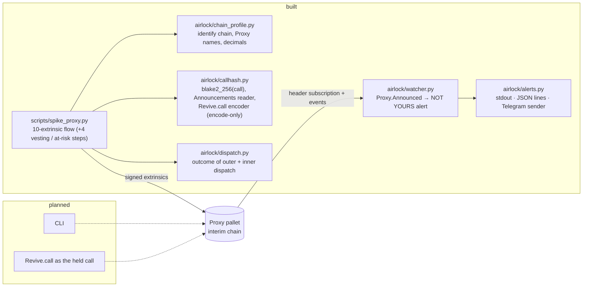

<div align="center">

# Airlock

**A time-locked hot key for a Portaldot vault: every spend is announced on-chain, waits out a delay, and your cold key can veto it first.**


</div>

> **Status: work in progress (README v0).** Portaldot Hacker House 2026 · track: Ecosystem DApps. The Portaldot V3
> testnet RPC (`testnetv3-node.feso-apps.xyz`) had no DNS record at 2026-10-14 01:04 UTC (again at 11:30 UTC), so everything below ran on
> **labelled interim chains, not V3** (see [docs/PROOF.md](docs/PROOF.md)). No V3 claim is made until a V3 run exists.

## Project Name

**Airlock** — repo `portaldot-hackathon-2026-airlock-edycu`.

## Project Overview

### Problem Statement

A POT holder who keeps funds on one hot key loses them in one block when that seed leaks. A multisig fixes this but
needs a second signer for every payment, which is heavy for one person. The Substrate Proxy pallet already ships a
better primitive, time-delayed proxies with announcements and a veto, but we did not find a product built around it.

### Solution

Airlock creates a **pure-proxy vault**, a keyless account, controlled by two keys:

- **Hot key** — a proxy *with a delay D*. It cannot spend directly (`Proxy.Unannounced`). It can only
  `announce(vault, blake2_256(call))`, wait D blocks, then `proxy_announced`.
- **Cold key** — a proxy with delay 0. It can dispatch `reject_announcement` as the vault (the **veto**) before D elapses.

A leaked hot key therefore buys a thief an announcement that the owner can see and cancel. A legitimate payment is the
same flow with no veto.

### Blockchain Relevance

Everything is enforced by the chain's own Proxy pallet; Airlock adds no custom runtime code. The proof is a set of real
extrinsics from local interim chains, listed by extrinsic id in [docs/PROOF.md](docs/PROOF.md). `interim-sdk` rows can be
re-fetched from its archive node; `interim-1002` runs with `--tmp`, so its rows are a run log only.

## Technical Architecture



| Layer | Choice |
|---|---|
| Target blockchain | **Portaldot V3 testnet** (not reachable on 2026-10-14; no run on it yet) |
| Chain used so far | `interim-sdk`: upstream polkadot-sdk `substrate-node` dev chain, tag `polkadot-stable2606-3`, runtime `node/268`; `interim-1002`: the `portaldot_dev` dev node from the Portaldot node repository (`portaldotVolunteer/Portaldot-node`), runtime `portaldot/1002`. Both are labelled "interim — not V3" |
| Contract language | none: pallet-native (Proxy pallet) |
| Client | Python 3.10+, `substrate-interface` 1.8.1, `scalecodec` 1.2.12 |
| Watcher | Python, SQLite (stdlib `sqlite3`), alerts on stdout / JSON lines; Telegram `sendMessage` sender built and tested against a mock Bot API, no bot connected yet |
| Frontend | none (the CLI is planned; a web UI is not in the current plan) |

## Smart Contracts

Airlock is **pallet-native**: there is no contract to deploy. The calls it uses, all from the Proxy pallet unless noted:

| Call | Who | Purpose |
|---|---|---|
| `create_pure` (`anonymous` on `interim-1002`) | cold | create the keyless vault |
| `proxy(add_proxy)` | cold, as vault | register the hot key with delay D |
| `announce` | hot | publish `blake2_256(call)` for a pending spend |
| `reject_announcement` (through `proxy`) | cold, as vault | the veto |
| `proxy_announced` | hot | execute after D, only if announced and not vetoed |
| `Balances.transfer_keep_alive` | the held call | the spend being gated |

- Code: [airlock/](airlock/) (chain profile, call hash, dispatch outcome, watcher, alerts) and [scripts/spike_proxy.py](scripts/spike_proxy.py).
- Deployment: nothing to deploy. A vault is created by the script's first step.
- IDs: vault addresses, extrinsic ids, block hashes and tx hashes are in [docs/PROOF.md](docs/PROOF.md). No V3 IDs exist yet.

## Installation & Setup

### Requirements

- Python 3.10+ (tests run on 3.11)
- macOS on Apple Silicon for the pinned `interim-sdk` node binary (`scripts/interim_node.sh` exits with a message on
  other systems; build `substrate-node` from the same tag there). `interim-1002` needs the `portaldot_dev` binary from
  the Portaldot node repo, set as `PORTALDOT_DEV`.
- `curl` and `shasum` (the launcher downloads the node binary and checks its sha256)

### Steps

(The repository is private until the public flip; until then clone with access.)

```bash
git clone https://github.com/edycutjong/portaldot-hackathon-2026-airlock-edycu.git
cd portaldot-hackathon-2026-airlock-edycu
python3 -m venv .venv && . .venv/bin/activate
pip install -e '.[dev]'

pytest -q                          # 167 unit tests, no chain or network needed (metadata fixtures committed; Telegram mocked on localhost)

scripts/interim_node.sh interim-sdk   # terminal 1: dev chain on ws://127.0.0.1:29944 (archive state)
python scripts/spike_proxy.py --profile interim-sdk   # terminal 2: the 10-extrinsic flow, ~1 min
python scripts/refetch.py evidence/spike-proxy-interim-sdk-<time>.json --url http://127.0.0.1:29944   # re-read it by id
python -m airlock.watcher --profile interim-sdk --vault <vault address>   # alerts on every announcement for that vault
```

The spike prints each step with its extrinsic id and tx hash and writes `evidence/*.json`; `--vesting 20000` adds the
four vesting/at-risk steps, `--proof docs/PROOF.md` appends the rows of a passing run. The watcher is described in
[docs/WATCHER.md](docs/WATCHER.md). There is no frontend to launch.

## Demo

- **Video:** coming at check-in.
- **Live demo:** none yet.
- **Proof:** [docs/PROOF.md](docs/PROOF.md) — 28 extrinsics (14 per chain profile), each with extrinsic id, block hash and
  tx hash, labelled "interim — not V3", each re-fetched by extrinsic id over HTTP from a fresh process. Per run: an
  unannounced spend fails (`Unannounced`), the announced theft call's hash equals the stored `Proxy.Announcements` entry, a
  vetoed call stays dead after the delay, an early execution fails, the same payment without a veto executes after the
  delay and moves exactly the announced amount, vesting-locked funds in the vault are not counted as at risk, and the
  at-risk figure is exact on chain: one planck more fails on the lock, exactly that amount moves.
- **Watcher:** [docs/WATCHER.md](docs/WATCHER.md) — NOT YOURS alerts (stdout + JSON lines) triggered by a
  `Proxy.announce` from [scripts/raw_announce.py](scripts/raw_announce.py), which imports nothing from Airlock: live on
  both interim chains, and on `interim-sdk` also after the watcher was stopped, after the node was restarted mid-watch,
  and after the node was frozen (no headers) mid-watch. Reorg re-scan, reset-chain stop, retries and the pruned-state
  gap are covered by unit tests only. No alert has reached a phone yet (no Telegram bot token configured).
- **Test accounts:** dev keys only (`//Alice` cold — `//Dave` on `interim-1002`, `//Bob` hot, `//Eve` thief's payee, `//Ferdie` legitimate payee; `//Charlie` is the delegate in the watcher runs) on the interim
  chains. The script refuses any chain whose genesis and runtime code hash are not a known interim profile.

## Roadmap

**Completed (2026-10-14)**

- Chain profile detection (genesis + runtime code hash → profile, Proxy names, decimals, block time); unknown chains fail loudly.
- Call hashing and the `Proxy.Announcements` reader; encode-only `Revive.call` composer (not exercised on a chain).
- End-to-end 10-extrinsic Proxy flow on two interim chains (+4 vesting/at-risk steps), 28 recorded extrinsics in
  PROOF.md, all re-fetched by extrinsic id.
- Watcher: header subscription, `Proxy.Announced` decoding, pending sweep, NOT YOURS alerts with an exact at-risk
  balance, veto deadline and the veto command, SQLite state, catch-up after downtime, reconnect and stall watchdog
  (shown live); reorg re-scan and retries (unit-tested); Telegram sender tested against a mock Bot API.

**Next**

- Run the same flow on the Portaldot V3 testnet as soon as its RPC is reachable, and label those rows `v3`.
- A CLI to create a vault, announce, execute and veto (the command the alert prints).
- Telegram alerts on a real phone once a bot token is configured.
- `Revive.call` as a held call type, only if it can be proven through a vault origin on a chain.
- Benchmarks, a demo video with live transactions, and the check-in submission (Oct 24).

## Team

- **Team:** `edycu`
- **Members & roles:** edycu — solo: design, on-chain protocol choices, review.
- **Contact:** via the DoraHacks BUIDL page (hackathon contact only).

**AI assistance disclosure.** Most of the code, tests and this README were drafted by Claude (Claude Code) and reviewed
by the author. The architecture, the choice of the Proxy-pallet mechanism and the on-chain design decisions are the
author's, who will explain every core flow live at Demo Day. All code in this repository was written during the
hackathon window; earlier exploratory scripts live outside the repository and were not copied in.
Open-source libraries: [`substrate-interface`](https://github.com/JAMdotTech/py-polkadot-sdk) and `scalecodec`
(Apache-2.0); the `interim-sdk` chain is the unmodified `substrate-node` release from
[paritytech/polkadot-sdk](https://github.com/paritytech/polkadot-sdk).

## License

[MIT](LICENSE)
