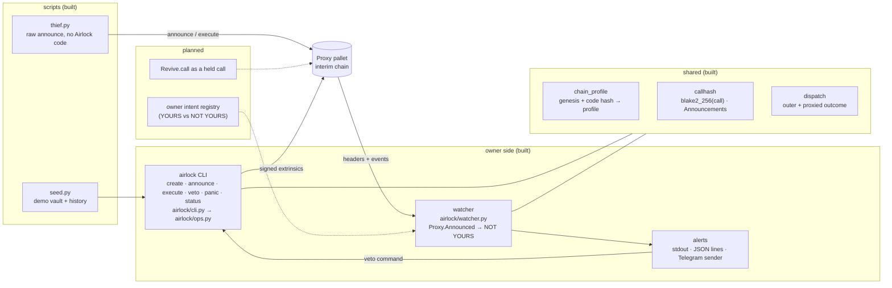

<div align="center">

# Airlock

**A time-locked hot key for a Portaldot vault: every spend is announced on-chain, waits out a delay, and your cold key can veto it first.**


</div>

> **Status: work in progress (README v1).** Portaldot Hacker House 2026 · track: Ecosystem DApps. The Portaldot V3
> testnet RPC (`testnetv3-node.feso-apps.xyz`) did not resolve on 2026-10-14 (`NXDOMAIN`, last checked 15:27 UTC,
> [evidence/v3-dns.txt](evidence/v3-dns.txt)), so everything below ran on **labelled interim chains, not V3** (see
> [docs/PROOF.md](docs/PROOF.md)). No V3 claim is made until a V3 run exists.

## Project Name

**Airlock** — repo `portaldot-hackathon-2026-airlock-edycu`.

## Project Overview

### Problem Statement

A POT holder who keeps funds on one hot key loses them in one block when that seed leaks. A multisig fixes this but
needs a second signer for every payment, which is heavy for one person. The Substrate Proxy pallet already ships a
better primitive, time-delayed proxies with announcements and a veto, but we did not find a product built around it.

### Solution

Airlock creates a **pure-proxy vault**, a keyless account, controlled by two keys:

- **Hot key** — a proxy *with a delay D*. It cannot spend directly (`Proxy.Unannounced`). It can only
  `announce(vault, blake2_256(call))`, wait D blocks, then `proxy_announced`.
- **Cold key** — a proxy with delay 0. It can dispatch `reject_announcement` as the vault (the **veto**) before D
  elapses, or `remove_proxy` to retire the hot key (**panic**).

A **watcher** follows every block and alerts on each announcement against the vault, with the amount at risk, the
block by which a veto must land, and the exact `airlock veto …` command to paste. A leaked hot key therefore buys a
thief an announcement that the owner sees and cancels. A legitimate payment is the same flow with no veto.

### Blockchain Relevance

Everything is enforced by the chain's own Proxy pallet; Airlock adds no custom runtime code. The proof is a set of real
extrinsics from local interim chains, listed by extrinsic id in [docs/PROOF.md](docs/PROOF.md) and re-fetched by id
from a fresh process over HTTP. `interim-sdk` keeps its state on disk (archive node), so its rows stay re-fetchable;
`interim-1002` runs with `--tmp`, so its rows are a run log once that node stops.

## Technical Architecture



| Layer | Choice |
|---|---|
| Target blockchain | **Portaldot V3 testnet** (not reachable on 2026-10-14; no run on it yet) |
| Chain used so far | two local interim dev chains, both labelled "interim — not V3" (table below) |
| Contract language | none: pallet-native (Proxy pallet) |
| Client | Python 3.10+, `substrate-interface` 1.8.1, `scalecodec` 1.2.12 |
| Owner interface | the `airlock` command line ([docs/CLI.md](docs/CLI.md)); no web UI |
| Watcher | Python, SQLite (stdlib `sqlite3`), alerts on stdout / JSON lines; Telegram `sendMessage` sender built and tested against a mock Bot API, no bot connected yet |

| Profile | Endpoint (local) | Chain | Runtime | Genesis hash |
|---|---|---|---|---|
| `interim-sdk` | `ws://127.0.0.1:29944` | upstream polkadot-sdk `substrate-node` dev chain, tag `polkadot-stable2606-3` | `node/268` | `0x0c4402ef4ccc34d28b16523e1cf26831716527c61a65d8e0840ab26e1636c8a2` |
| `interim-1002` | `ws://127.0.0.1:19944` | `portaldot_dev` from the Portaldot node repository (`portaldotVolunteer/Portaldot-node`) | `portaldot/1002` | `0x53c36c0fc46f5bb2429d701b5ad7a0577b343aa53c4964333f1922611974dd22` |

Every tool identifies the chain by genesis hash and runtime code hash before signing and refuses an unknown one
([airlock/chain_profile.py](airlock/chain_profile.py)); the profile supplies the Proxy call names (`create_pure` vs
`anonymous` on 1002), decimals and block time.

## Smart Contracts

Airlock is **pallet-native**: there is no contract to deploy. The calls it uses, all from the Proxy pallet unless noted:

| Call | Who | Purpose |
|---|---|---|
| `create_pure` (`anonymous` on `interim-1002`) | cold | create the keyless vault |
| `proxy(add_proxy)` | cold, as vault | register the hot key with delay D |
| `announce` | hot | publish `blake2_256(call)` for a pending spend |
| `proxy(reject_announcement)` | cold, as vault | the veto |
| `proxy_announced` | hot | execute after D, only if announced and not vetoed |
| `proxy(remove_proxy)` | cold, as vault | panic: retire the hot key |
| `remove_announcement` | hot | take back one's own announcement |
| `Balances.transfer_keep_alive` | the held call | the spend being gated |

- Code: [airlock/](airlock/) (CLI and operations, chain profile, call hash, dispatch outcome, watcher, alerts) and
  [scripts/](scripts/).
- Deployment: nothing to deploy. `airlock create` (or `scripts/seed.py`) creates a vault.
- IDs: vault addresses, extrinsic ids, block hashes and tx hashes are in [docs/PROOF.md](docs/PROOF.md). No V3 IDs exist yet.

## Installation & Setup

### Requirements

- Python 3.10+ (the test suite passes on 3.11.1 and 3.10.20)
- macOS on Apple Silicon for the pinned `interim-sdk` node binary (`scripts/interim_node.sh` exits with a message on
  other systems; build `substrate-node` from the same tag there). `interim-1002` needs the `portaldot_dev` binary from
  the Portaldot node repo, set as `PORTALDOT_DEV`.
- `curl` and `shasum` (the launcher downloads the node binary and checks its sha256)

### Steps

(The repository is private until the public flip; until then clone with access.)

```bash
git clone https://github.com/edycutjong/portaldot-hackathon-2026-airlock-edycu.git
cd portaldot-hackathon-2026-airlock-edycu
python3 -m venv .venv && . .venv/bin/activate
pip install -e '.[dev]'                 # also installs the `airlock` command

pytest -q                               # 224 passed, 4 skipped: no chain or network needed (the 4 are the live-chain tests)

scripts/interim_node.sh interim-sdk     # terminal 1: dev chain on ws://127.0.0.1:29944 (archive state)

# terminal 2
python scripts/seed.py --profile interim-sdk          # demo vault + history (~3 min), checks fixtures/expected.json
scripts/e2e_evidence.sh interim-sdk                   # thief -> NOT YOURS alert -> veto -> thief fails (~2 min)
AIRLOCK_IT=1 AIRLOCK_PROFILE=interim-sdk pytest -q tests/integration   # I1, I2, control, panic on the chain (~90 s)
```

By hand, on the seeded vault (dev keys are accepted only on the interim chains; elsewhere use `file:<path>`):

```bash
export AIRLOCK_PROFILE=interim-sdk AIRLOCK_COLD_KEY=//AirlockDemo//cold
python -m airlock.watcher --vault <demo vault>                                       # terminal 3: alerts
python scripts/thief.py --vault <demo vault> --to <any address> --amount all         # the thief announces a sweep
airlock veto --vault <demo vault> --delegate <hot> --hash <call hash>                # the line the alert prints
python scripts/thief.py --vault <demo vault> --to <same address> --amount all --execute   # after D: Proxy.Unannounced
airlock status --vault <demo vault>
```

`seed.py` prints the demo vault and hot-key addresses. The other tools: `scripts/spike_proxy.py` (the 10-extrinsic
protocol walk-through, `--vesting` adds 4 at-risk steps), `scripts/refetch.py` (re-read recorded extrinsics by id),
the watcher ([docs/WATCHER.md](docs/WATCHER.md)) and the CLI ([docs/CLI.md](docs/CLI.md)).

## Demo

- **Video:** coming at check-in.
- **Live demo:** none yet (local chains only).
- **End to end** ([scripts/e2e_evidence.sh](scripts/e2e_evidence.sh), logs in [evidence/](evidence/)), on both interim
  chains at commit `ab8a03d`: [scripts/thief.py](scripts/thief.py), which imports no Airlock code, announces a sweep of
  the demo vault's whole at-risk balance (4,670.15 UNIT on `interim-sdk`) → the watcher prints a NOT YOURS alert with
  the veto deadline (19 blocks, ≈ 57 s, on `interim-sdk`) → the alert's own `airlock veto …` line, run as printed,
  rejects the announcement → after the delay the thief's `proxy_announced` fails `Proxy.Unannounced`, and so does a
  direct `proxy.proxy`; vault and thief-payee totals are unchanged. The thief's extrinsics re-fetch 3/3 by id over
  HTTP on each chain.
- **Seed** ([scripts/seed.py](scripts/seed.py)): the demo vault's history on each chain — 27 extrinsics on
  `interim-sdk`, 29 on `interim-1002`, 8 call types each (5 legitimate spends executed after the delay, 2 drains
  vetoed, one executed after its veto and failing, one withdrawn announcement, a panic) — and the end-state checks of
  [fixtures/expected.json](fixtures/expected.json) all hold. Re-fetched 27/27 and 29/29 by extrinsic id.
- **Proof:** [docs/PROOF.md](docs/PROOF.md) — every row with extrinsic id, block hash, tx hash and the profile label.
- **Tests:** 224 offline tests, plus 4 live-chain integration tests (I1: a delayed hot key cannot spend unannounced;
  I2: a vetoed announcement never executes, also after the delay; the control; panic) that pass on both interim chains.
- **Watcher:** [docs/WATCHER.md](docs/WATCHER.md) — also shown live after a watcher restart, a node restart and a node
  freeze (recorded by [scripts/watcher_evidence.sh](scripts/watcher_evidence.sh)). No alert has reached a phone yet
  (no Telegram bot token configured).
- **Test accounts:** dev keys only, on the interim chains: the demo accounts `//AirlockDemo//cold`, `//AirlockDemo//hot`,
  … ([fixtures/accounts.json](fixtures/accounts.json)) funded by `//Alice` (`//Dave` on `interim-1002`); the spike and
  watcher runs use `//Alice`–`//Ferdie`.

## Roadmap

**Completed (2026-10-14)**

- Chain profile detection (genesis + runtime code hash → profile, Proxy names, decimals, block time); unknown chains fail loudly.
- Call hashing and the `Proxy.Announcements` reader; encode-only `Revive.call` composer (not exercised on a chain).
- End-to-end Proxy flow on two interim chains: protocol walk-through (`spike_proxy.py`), seeded demo history, all
  recorded in PROOF.md and re-fetched by extrinsic id.
- Watcher: header subscription, `Proxy.Announced` decoding, NOT YOURS alerts with the at-risk balance, veto deadline
  and veto command, catch-up after downtime, reconnect after a node restart, stall watchdog. Unit-tested only: pending
  sweep, reorg re-scan, reset-chain stop, retries, pruned or undecodable blocks, the Telegram sender (mock Bot API).
- CLI `airlock create / announce / execute / veto / panic / status`: each command reads the chain before signing and
  confirms its effect afterwards; keys only from a file or an environment variable (dev keys on interim chains).
- `seed.py` + fixtures, `thief.py`, and the thief → alert → veto → `Unannounced` run on both interim chains.

**Next**

- Run the same flow on the Portaldot V3 testnet as soon as its RPC is reachable, and label those rows `v3`.
- The owner intent registry, so the owner's own announcements show as YOURS and everything else stays NOT YOURS.
- Telegram alerts on a real phone once a bot token is configured.
- Benchmarks (alert and veto latency), a demo video with live transactions, and the check-in submission (Oct 24).
- `Revive.call` as a held call type, only if it can be proven through a vault origin on a chain.

## Team

- **Team:** `edycu`
- **Members & roles:** edycu — solo: design, on-chain protocol choices, review.
- **Contact:** via the DoraHacks BUIDL page (hackathon contact only).

**AI assistance disclosure.** Most of the code, tests and this README were drafted by Claude (Claude Code) and reviewed
by the author. The architecture, the choice of the Proxy-pallet mechanism and the on-chain design decisions are the
author's, who will explain every core flow live at Demo Day. All code in this repository was written during the
hackathon window; earlier exploratory scripts live outside the repository and were not copied in.
Open-source libraries: [`substrate-interface`](https://github.com/JAMdotTech/py-polkadot-sdk) and `scalecodec`
(Apache-2.0); the `interim-sdk` chain is the unmodified `substrate-node` release from
[paritytech/polkadot-sdk](https://github.com/paritytech/polkadot-sdk).

## License

[MIT](LICENSE)
